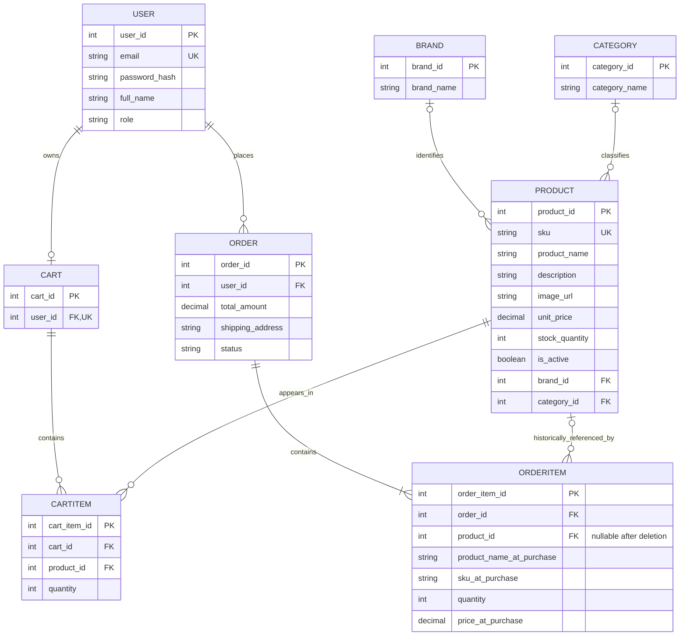

# 06_ER_Diagram — Crow’s Foot

**Notes on interpretation**
- `USER` to `CART`: the application intends at most one cart per user (`cart.user_id` is UNIQUE), although a cart may be created only when needed.
- `ORDERITEM.product_id` is nullable and uses **ON DELETE SET NULL**; the stored name, SKU and price preserve order history.
- `CARTITEM.product_id` uses **ON DELETE CASCADE**.
- `PRODUCT.brand_id` and `PRODUCT.category_id` are nullable. A product can therefore have zero or one brand/category.
- The diagram reflects confirmed relationships and fields plus a few application-level assumptions; confirm the full `SHOW CREATE TABLE` output for `user`, `brand`, `category`, `cart` and `order` before final submission. In particular, mandatory participation (such as an order always having items) is a business rule, not necessarily enforced by a foreign key.

