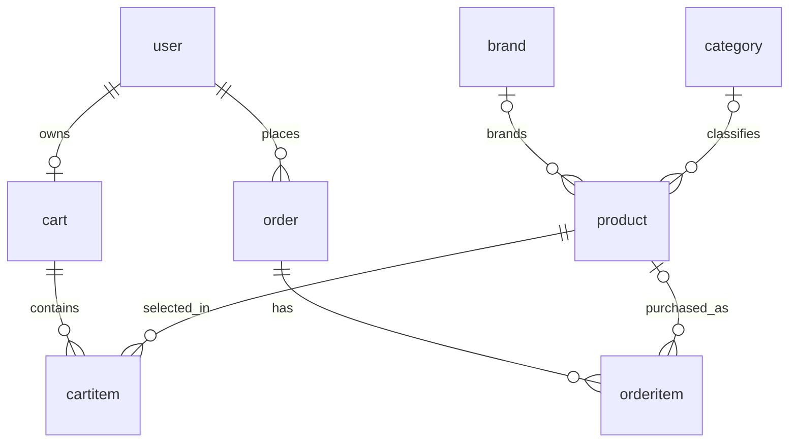

# 3DPrinter-Store — Database Schema

This document describes the **current eight-table MariaDB schema**, based on the `SHOW CREATE TABLE` results obtained from the running database. Table names, types, constraints and foreign-key actions below reflect those definitions, rather than the original six-entity design.

## 1. Entities

| Entity (table) | Purpose |
|---|---|
| `user` | Customer, employee, and administrator accounts and contact information |
| `brand` | Product brand master records |
| `category` | Product category master records |
| `product` | Product catalog, prices, images, stock, and active status |
| `cart` | Persistent cart belonging to a user |
| `cartitem` | Items and quantities in a cart |
| `order` | Order header, shipping address, total, and status |
| `orderitem` | Purchased line items and their purchase-time snapshots |

## 2. Entity Relationships

| Parent → Child | Cardinality | Foreign key | Delete behavior |
|---|---|---|---|
| `user` → `cart` | 1 → 0..1 (one cart maximum per user) | `cart.user_id` (`UNIQUE`, `NOT NULL`) | `CASCADE` |
| `user` → `order` | 1 → 0..N | `order.user_id` (`NOT NULL`) | `CASCADE` |
| `brand` → `product` | 1 → 0..N; product brand optional | `product.brand_id` (nullable) | Default `RESTRICT`/`NO ACTION` |
| `category` → `product` | 1 → 0..N; product category optional | `product.category_id` (nullable) | Default `RESTRICT`/`NO ACTION` |
| `cart` → `cartitem` | 1 → 0..N | `cartitem.cart_id` (`NOT NULL`) | `CASCADE` |
| `product` → `cartitem` | 1 → 0..N | `cartitem.product_id` (`NOT NULL`) | `CASCADE` |
| `order` → `orderitem` | 1 → 0..N | `orderitem.order_id` (`NOT NULL`) | Default `RESTRICT`/`NO ACTION` |
| `product` → `orderitem` | 1 → 0..N; line-item product optional after deletion | `orderitem.product_id` (nullable) | `SET NULL` |

**Important deletion behavior:** Deleting a product removes its `cartitem` references, but does **not** delete historical `orderitem` rows: their `product_id` becomes `NULL`. The product name, SKU, and price snapshots remain. Deleting a user cascades to `cart` and `order` records; however, existing `orderitem` children can prevent an order from being deleted because their foreign key has no cascade action. Thus the database does **not** guarantee that every user deletion will succeed automatically.

The application normally creates a cart during registration (or on first cart access), but the database's unique constraint guarantees **at most one** cart per user; it does not force every user to have one.

### Crow's Foot ER diagram (Mermaid)

> `order` and `user` are SQL identifiers; quote `order` (and preferably `user`) with backticks in MariaDB statements.

## 3. Relationship Optimization

- `cartitem` resolves the many-to-many association between carts and products. The composite unique index `unique_cart_product (cart_id, product_id)` prevents duplicate product rows within a cart; quantity is updated instead.
- `orderitem` resolves the historical many-to-many association between orders and products. A product can appear in many orders; each order has separate line items.
- Brands and categories are separate lookup tables to avoid repeated names in every product row.
- `orderitem.product_name_at_purchase`, `sku_at_purchase`, and `price_at_purchase` intentionally store historical snapshots. Current product names and prices may change, or a product may be deleted, without rewriting prior purchase details.
- `order.total_amount` is a stored order total (not dynamically computed on every read), while purchase-time prices belong to individual order items.

## 4. Attribute Definitions

**Legend:** PK = Primary Key; FK = Foreign Key; UQ = Unique; AI = Auto Increment; NN = Not Null. All tables use the InnoDB engine and `utf8mb4` with `utf8mb4_general_ci` collation in the provided schema.

### 4.1 `user`

| Attribute | MariaDB type | Constraints / default | Description |
|---|---|---|---|
| `user_id` | `INT(11)` | PK, AI, NN | Account identifier |
| `email` | `VARCHAR(255)` | UQ, NN | Login email |
| `password_hash` | `VARCHAR(255)` | NN | Password hash (not plaintext) |
| `full_name` | `VARCHAR(100)` | NN | Account holder's name |
| `phone` | `VARCHAR(20)` | NULL allowed, default NULL | Phone number |
| `address` | `TEXT` | NULL allowed, default NULL | Profile address |
| `role` | `ENUM('customer','employee','admin')` | NN, default `'customer'` | Account role |
| `created_at` | `TIMESTAMP` | NN, default `CURRENT_TIMESTAMP()` | Account creation time |

### 4.2 `brand`

| Attribute | MariaDB type | Constraints / default | Description |
|---|---|---|---|
| `brand_id` | `INT(11)` | PK, AI, NN | Brand identifier |
| `brand_name` | `VARCHAR(50)` | UQ, NN | Brand name |

### 4.3 `category`

| Attribute | MariaDB type | Constraints / default | Description |
|---|---|---|---|
| `category_id` | `INT(11)` | PK, AI, NN | Category identifier |
| `category_name` | `VARCHAR(50)` | UQ, NN | Category name |

### 4.4 `product`

| Attribute | MariaDB type | Constraints / default | Description |
|---|---|---|---|
| `product_id` | `INT(11)` | PK, AI, NN | Product identifier |
| `sku` | `VARCHAR(50)` | UQ, NN | Stock-keeping unit |
| `product_name` | `VARCHAR(150)` | NN | Product title |
| `description` | `TEXT` | NULL allowed | Product details |
| `image_url` | `VARCHAR(255)` | NULL allowed | Product image path or URL |
| `unit_price` | `DECIMAL(10,2)` | NN, `CHECK (unit_price >= 0)` | Current unit price |
| `stock_quantity` | `INT(11)` | NN, default `0`, `CHECK (stock_quantity >= 0)` | Available quantity |
| `brand_id` | `INT(11)` | Nullable FK → `brand.brand_id` | Brand, if assigned |
| `category_id` | `INT(11)` | Nullable FK → `category.category_id` | Category, if assigned |
| `is_active` | `TINYINT(1)` | NN, default `1` | 1 = listed; 0 = hidden |

### 4.5 `cart`

| Attribute | MariaDB type | Constraints / default | Description |
|---|---|---|---|
| `cart_id` | `INT(11)` | PK, AI, NN | Cart identifier |
| `user_id` | `INT(11)` | UQ, NN, FK → `user.user_id` (`ON DELETE CASCADE`) | Owner; unique makes cart 1:0..1 per user |
| `created_at` | `TIMESTAMP` | NN, default `CURRENT_TIMESTAMP()` | Cart creation time |
| `updated_at` | `TIMESTAMP` | NN, default `CURRENT_TIMESTAMP()`, auto-updated | Last row update time |

### 4.6 `cartitem`

| Attribute | MariaDB type | Constraints / default | Description |
|---|---|---|---|
| `cart_item_id` | `INT(11)` | PK, AI, NN | Cart line identifier |
| `cart_id` | `INT(11)` | NN, FK → `cart.cart_id` (`ON DELETE CASCADE`) | Parent cart |
| `product_id` | `INT(11)` | NN, FK → `product.product_id` (`ON DELETE CASCADE`) | Selected product |
| `quantity` | `INT(11)` | NN, default `1`, `CHECK (quantity > 0)` | Units selected |
| `created_at` | `TIMESTAMP` | NN, default `CURRENT_TIMESTAMP()` | Item creation time |

Composite UQ constraint: `unique_cart_product(cart_id, product_id)`.

### 4.7 `order`

| Attribute | MariaDB type | Constraints / default | Description |
|---|---|---|---|
| `order_id` | `INT(11)` | PK, AI, NN | Order identifier |
| `user_id` | `INT(11)` | NN, FK → `user.user_id` (`ON DELETE CASCADE`) | Ordering user |
| `order_date` | `TIMESTAMP` | NN, default `CURRENT_TIMESTAMP()` | Order placement time |
| `total_amount` | `DECIMAL(10,2)` | NN | Stored order total |
| `shipping_address` | `TEXT` | NN | Address used for this order |
| `status` | `ENUM('Pending','Paid','Shipped','Delivered','Cancelled')` | NN, default `'Pending'` | Fulfillment status |

### 4.8 `orderitem`

| Attribute | MariaDB type | Constraints / default | Description |
|---|---|---|---|
| `order_item_id` | `INT(11)` | PK, AI, NN | Order line identifier |
| `order_id` | `INT(11)` | NN, FK → `order.order_id` (default delete behavior) | Parent order |
| `product_id` | `INT(11)` | Nullable FK → `product.product_id` (`ON DELETE SET NULL`) | Referenced product if still present |
| `quantity` | `INT(11)` | NN, `CHECK (quantity > 0)` | Purchased quantity |
| `price_at_purchase` | `DECIMAL(10,2)` | NN, `CHECK (price_at_purchase >= 0)` | Unit price when purchased |
| `product_name_at_purchase` | `VARCHAR(150)` | NULL allowed | Purchased product name snapshot |
| `sku_at_purchase` | `VARCHAR(50)` | NULL allowed | Purchased SKU snapshot |

## 5. Constraints and Business Logic Notes

- **Unique:** `user.email`, `brand.brand_name`, `category.category_name`, `product.sku`, `cart.user_id`, and `cartitem(cart_id, product_id)`.
- **Checks:** product price and stock are nonnegative; cart and order item quantities are positive; purchased item price is nonnegative.
- **Role values:** customer, employee, admin. **Order status values:** Pending, Paid, Shipped, Delivered, Cancelled.
- The database schema does not itself enforce all application rules. For example, the Express backend validates stock at checkout, handles order status transitions, and updates inventory using database transactions.
- The original six-entity `Customer` design is **superseded**. The live table is `user`, and the cart/cartitem entities are now part of the model.
- `AUTO_INCREMENT` counters from `SHOW CREATE TABLE` are omitted here because they are runtime state, not fixed schema design.

## 6. Source and Scope

This document reflects all eight `SHOW CREATE TABLE` statements supplied from the live MariaDB database. It documents **structure, not data**. The final `.sql` export should additionally contain the actual `CREATE DATABASE`, `CREATE TABLE`, and any required `INSERT INTO` statements or a sanitized backup.
