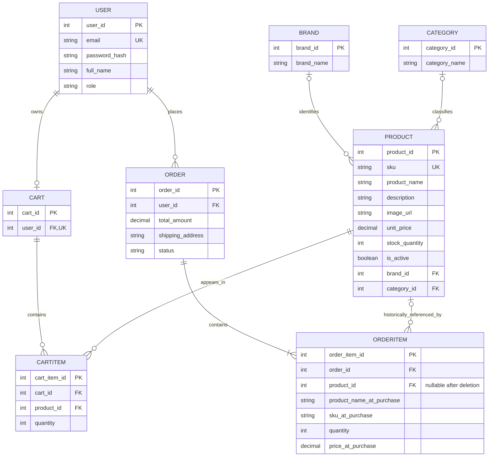

# 06_ER_Diagram — แผนภาพ ER แบบ Crow’s Foot

**หมายเหตุในการตีความแผนภาพ**
- `USER` ต่อ `CART`: แอปพลิเคชันกำหนดให้ผู้ใช้มีตะกร้าได้ไม่เกินหนึ่งใบ (`cart.user_id` เป็น UNIQUE) และอาจสร้างตะกร้าเมื่อต้องใช้งาน
- `ORDERITEM.product_id` ยอมรับ `NULL` และใช้ **ON DELETE SET NULL** โดยชื่อสินค้า SKU และราคาที่บันทึกไว้จะคงอยู่ในประวัติการสั่งซื้อ
- `CARTITEM.product_id` ใช้ **ON DELETE CASCADE**
- `PRODUCT.brand_id` และ `PRODUCT.category_id` เป็น `NULL` ได้ จึงอาจไม่มีแบรนด์หรือหมวดหมู่ หรือมีอย่างละหนึ่งรายการ
- แผนภาพใช้ความสัมพันธ์และฟิลด์ที่ตรวจสอบได้ร่วมกับข้อกำหนดระดับแอปพลิเคชันบางส่วน ก่อนส่งงานควรตรวจ `SHOW CREATE TABLE` ของ `user`, `brand`, `category`, `cart` และ `order` เพื่อยืนยันข้อกำหนดทุกจุด โดยการบังคับว่าออร์เดอร์ต้องมีสินค้าอย่างน้อยหนึ่งรายการเป็นกฎธุรกิจ ไม่ได้หมายความว่า FK บังคับได้โดยตรง

